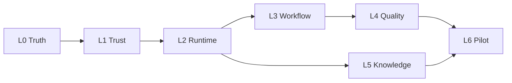

# Loop Graph

The driver prompt `NEXUS_LOOP.md` (installed as `/nexus`) reads this file on every tick to decide which loop to work in. `scripts/graph-lint.mjs` runs inside `npm run gate` and fails when a loop line, a ledger, or the diagram below disagree, or when any citation in these documents stops resolving.

Phases come from `roadmap/worldclassroadmap.md`; the plan and its evidence are in `docs/roadmap/NEXUS_WORLD_CLASS_ROADMAP.md`; shared rules are in `docs/LOOP_CONVENTIONS.md`.

## Three nested loops

1. **Graph loop** (this file): picks the active loop.
2. **Task loop** (one ledger task per tick): failing check first, smallest change, focused test, full gate, local commit, journal. It is the harness cycle drawn in `roadmap/worldclassroadmap.md#Pin repository commitDiscover code` without the parallel agents that document advises against.
3. **Verification loop** (each ledger's independent-check task): a different model attacks the work, at most 3 rounds, and a finding counts only as a reproducible failing test.

## Driver rules

1. The active loop is the first unticked loop below whose needs are all ticked.
2. In the active loop's ledger, take the first unticked task whose needs are all ticked and that is not marked (human).
3. If no such task exists in the active loop, try the next unticked loop whose needs are all ticked. If none has an agent task, stop and escalate, naming the (human) tasks that block.
4. Only the human ticks a loop line, after that loop's signoff task is ticked and `npm run gate` passes.
5. A loop's budget is ticks (entries in its Journal) or spend, whichever runs out first. The author picked these defaults; they are not cost estimates. Edit them here.

## Loops

- [x] L0 Truth. ledger: `docs/loops/L0_TRUTH.md` · needs: none. · budget 15 ticks or $15 · `roadmap/worldclassroadmap.md#Phase 0 — Establish the truth`
- [x] L1 Trust. ledger: `docs/loops/L1_TRUST.md` · needs: L0. · budget 25 ticks or $25 · `roadmap/worldclassroadmap.md#Phase 1 — Secure the platform`
- [ ] L2 Runtime. ledger: `docs/loops/L2_RUNTIME.md` · needs: L1. · budget 20 ticks or $25 · `roadmap/worldclassroadmap.md#Phase 2 — Make agents genuinely execute`
- [ ] L3 Workflow. ledger: `docs/loops/L3_WORKFLOW.md` · needs: L2. · budget 20 ticks or $20 · `roadmap/worldclassroadmap.md#Phase 3 — Turn the graph into a real product`
- [ ] L4 Quality. ledger: `docs/loops/L4_QUALITY.md` · needs: L3. · budget 15 ticks or $15 · `roadmap/worldclassroadmap.md#Phase 4 — Make quality measurable`
- [ ] L5 Knowledge. ledger: `docs/loops/L5_KNOWLEDGE.md` · needs: L2. · budget 15 ticks or $20 · `roadmap/worldclassroadmap.md#Phase 5 — Deliver useful enterprise data workflows`
- [ ] L6 Pilot. ledger: `docs/loops/L6_PILOT.md` · needs: L4, L5. · budget 10 ticks or $15 · `roadmap/worldclassroadmap.md#Phase 6 — Production pilot and monetization`

One edge per line below; graph-lint compares these edges with the `needs:` above.

